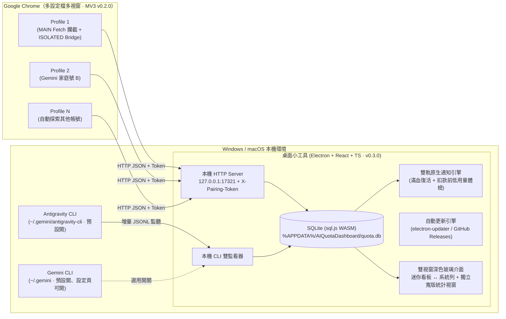

# AI 多帳號額度儀表板 — 專案規劃與實作規格書

> **文件用途**：本規格書記錄專案的核心需求、架構設計、實際資料模型、各階段開發進度與維護發佈規範，供後續開發與版本迭代直接銜接。  
> **建立日期**：2026-11-20  
> **最後更新**：2026-11-23（v0.3.2 · Phase 1–3 全功能完成，GitHub Actions Windows ＋ macOS ＋ Chrome 擴充套件全綠發佈成功）  
> **目標平台**：Windows / macOS 桌面端 ＋ Google Chrome（多設定檔 Profile 環境）  
> **GitHub 專案**：`dong1121/ai-quota-dashboard`（Public · 支援 GitHub Releases 自動更新與雙平台雲端打包）  
> **隱私原則**：Local-First（全本機運作、不經第三方雲端伺服器、不儲存帳號密碼、設定備份不含本機配對碼）

---

## 1. 專案背景與目標

同時訂閱多家 AI 服務且擁有多個帳號時，常見痛點為：
1. 不清楚目前哪個帳號還有額度、哪個快要重置。
2. 各家 AI 的額度規則與單位完全不同（5 小時百分比、每週額度、滾動次數、每日請求數）。
3. 同時跨 Chrome 多個設定檔視窗、桌面端應用程式（Claude Cowork）、本機 CLI（Antigravity CLI / Gemini CLI）與手機端使用，缺乏單一總覽視角。
4. 同時訂閱多項付費方案（含月繳／年繳／家庭群組），容易忘記自己其實很少使用某些服務而持續白繳訂閱費。

**本專案目標**：打造一套**本機運作、支援多帳號自動探索、跨 Windows/macOS、具備自動更新機制且可輕鬆分享給朋友使用**的輕量桌面小工具，搭配極簡 Chrome 擴充套件，實現跨平台額度監控、滿血提醒、每月統計與訂閱 CP 值體檢。

---

## 2. 目標服務與額度採集策略

### 2.1 服務清單與額度特性

| 服務名稱 | 使用入口 | 額度池規則 | 採集方式（已實作） | 精度等級 |
| :--- | :--- | :--- | :--- | :--- |
| **Claude Cowork** | Claude 桌面版 / 網頁 / 手機 | 5 小時滾動額度（Session）＋每週額度（Weekly）；各端共用同一額度池 | `claude.ai` 分頁同源直接查詢 `/api/organizations/{orgId}/usage`（抗 Cloudflare），並由 Service Worker 每 3 分鐘背景輪詢；同步寫入 `quota_snapshots` 歷史快照以計算月活躍天數與週均消耗率 | ⭐⭐⭐⭐⭐ 精準百分比＋重置倒數 |
| **Gemini Pro 家庭版** | Chrome 多設定檔 ＋ 手機版 | 家庭群組內每個成員帳號額度各自獨立，但帳單共計一份方案費 | 各 Chrome Profile 安裝同一擴充套件；透過 MAIN World 讀取 `WIZ_global_data.oPEP7c`（不依賴介面語系）精準取得 Google Email，攔截 `StreamGenerate` 計數與 `429`／多語系 DOM 備援 | ⭐⭐⭐ 估算記帳＋觸頂倒數 |
| **Antigravity CLI (AGY)** | 本機終端機 | 獨立開發者工具紀錄 | **預設開啟**：增量讀取 `~/.gemini/antigravity-cli/brain/*/.system_generated/logs/transcript.jsonl`，以 `external_event_id` 冪等去重，自動依 Email 歸戶為 `🚀 AGY` 槽位 | ⭐⭐⭐⭐ 精準步驟統計 |
| **標準 Gemini CLI（選用）** | 本機終端機 | 免費開發者額度池 | **預設關閉**（保持付費版使用者介面精簡；設定頁可一鍵開啟供免費版朋友使用）：讀取 `~/.gemini/google_accounts.json` 與 `tmp/**/chats/session-*.json`，統計次數與 Token | ⭐⭐⭐⭐ 精準次數與 Token |
| **ChatGPT Plus** | Chrome 網頁版 ＋ 手機版 | 依模型區分的滾動時間窗（推理模型、主力對話、深度研究、圖片生成） | MAIN World 攔截 `/backend-api/conversation` 依 `model` 自動分類計數，讀取 `/api/auth/session` 取得帳號 Email，並攔截 `429` / `clears_in` / `resets_at` 精準對齊重置時間 | ⭐⭐⭐⭐ 滾動估算＋限流校準 |

### 2.2 手機版使用量補齊機制（已實作）
1. **歷史對話差量同步（Delta Sync）**：擴充套件 v0.2.0 在開啟 ChatGPT 或 Gemini 網頁時，自動掃描近期對話清單時間戳／新對話 ID（避開本機剛發出的對話），以冪等 `external_event_id` 自動補記 `source: 'mobile_delta'`。
2. **卡片一鍵快捷微調**：桌面看板滑鼠移至 Gemini 網頁或 ChatGPT 槽位時，顯示 `+1`（快速補記）與 `觸頂` / `復原`（手動校準冷卻狀態）按鈕。
3. **配對後自動掃描已開啟分頁**：擴充套件 v0.1.1+ 使用 `tabs` + `scripting` 權限，於配對成功或點擊「掃描分頁並同步」時主動對已開啟的 AI 分頁補注入探針，免手動重新整理。

---

## 3. 系統整體架構

採用 **「雙層本地混合架構」**：Chrome 擴充套件（Manifest V3）作為無感資料採集探針，Electron 桌面小工具作為資料大腦、UI 看板、統計分析與通知中心。



### 3.1 本機通訊與安全設計（已實作）
* **純迴路介面**：僅監聽 `127.0.0.1:17321`，不對外網或區網開放。
* **隨機配對碼（Pairing Token）**：首次啟動自動生成 8 碼隨機配對碼（如 `K8M2-94Q1`），以 `crypto.timingSafeEqual` 驗證，可於設定頁一鍵複製或重製。
* **嚴格 CORS 隔離**：僅允許 `chrome-extension://` 與無 Origin 之本機請求，阻擋一般網站存取（回傳 `403`）。
* **零密碼接觸**：擴充套件僅利用瀏覽器原有登入狀態運作，不匯出任何密碼或 Cookie。

---

## 4. 核心產品功能與介面設計（已全數實作）

### 4.1 多帳號管理：自動探索 ＋ 個人化自訂
1. **開箱自動長出卡片**：打開支援的 AI 網頁後自動依 Email 正規化註冊；同 Email 的網頁與本機 CLI 自動合併於同一張卡片底下。
2. **卡片內聯編輯（Hover 展開）**：
   - 修改自訂別名（如 `家庭主力`）與 8 種對應 Chrome 視窗主題色標。
   - 單帳號滿血通知靜音開關、一鍵隱藏忽略帳號（設定頁可隨時恢復顯示）。
   - 標題列一鍵切換 **「手動排序（上移／下移）」↔「智慧排序（依目前剩餘可用額度由高到低自動排，滿血帳號排最前）」**。

### 4.2 雙模式桌面看板 ＋ 深色玻璃質感外觀微調
1. **模式 A：桌面常駐迷你看板（Widget Mode）**
   - 無邊框半透明深色玻璃質感（Dark Glassmorphism），支援拖曳、螢幕邊緣 16px 自動吸附與 `📌 Always on Top`。
2. **模式 B：系統列／選單列常駐（Tray Mode）＋ 全域快捷鍵**
   - 預設快捷鍵 `Alt + Q`（macOS 對應 `Option + Q`，設定頁可自訂），喚出時 Windows 對齊右下角工作列上方、macOS 對齊 Menu Bar 圖示正下方（並自動隱藏 Dock），失焦自動收合。
3. **雙視窗獨立外觀控制（即時預覽＋自動記憶）**：
   - **迷你看板**：設定頁可獨立調整**字體大小（85%–135%，含精巧／標準／大字／特大）**與**背景不透明度（55%–100%）**。
   - **獨立統計視窗**：標題列內建 **`[外觀]`** 浮層按鈕，可獨立調整**統計頁字體大小（85%–135%）**與**背景不透明度（70%–100%，預設 96% 確保圖表清晰好讀）**。

### 4.3 獨立寬版統計與訂閱 CP 值體檢視窗（點擊 `[📊]` 開啟）
獨立開啟 `960 × 680` 深色玻璃寬版視窗，關閉不影響小看板常駐：
* **期間切換**：支援 `近 7 天`、`本月`、`上個月`、`近 90 天`。
* **4 張 KPI 總覽卡**：期間總互動次數（含較前期增減 %）、折算每月總訂閱費（月繳＋年繳均攤）、總活躍天數、整體平均單次成本。
* **雙層統計設計（家庭群組 vs 多帳號）**：
  - **方案層級 CP 值體檢卡**：以「整份付費方案」為單位彙總底下所有帳號用量（例如 Gemini 家庭版僅計一份費用，不會重複計費也不誤判停訂）；支援設定 **月繳（每月扣款日 1–31）** 或 **年繳（續約月／日，自動折算均攤月費）**，自動評等 `🟢 超值主力` / `🟡 偏低使用` / `🔴 建議檢討停訂` / `⏸️ 已停訂封存`，並提供「本月忽略 30 天」與「已停訂（保留歷史紀錄）」。
  - **帳號層級負載分佈圖**：列出各帳號在同服務內的佔比與單帳號閒置天數，方便掌握家庭成員或分身帳號負載。
* **視覺化圖表**：每日使用趨勢堆疊柱狀圖（懸停顯示各服務明細）＋ 24 小時使用高峰分佈圖（輔助設定夜間勿擾時段）。

### 4.4 雙軌系統原生通知引擎
* **⚡ 滿血復活提醒**：偵測 Claude 5h／每週額度重置歸零，或 Gemini／ChatGPT 觸頂冷卻恢復可用時發送系統原生通知（Windows 已正確設定 `AppUserModelId` 確保 Action Center 正常彈出）。
* **💰 低用量／扣款前省錢體檢提醒**：
  - 月繳方案於扣款前 N 天（預設 3 天）、年繳方案於續約前 N 天（預設 7 天）自動檢查低用量並發送溫和提醒。
  - 付費方案連續閒置達門檻（預設 14 天）時提醒檢討，透過 `notification_logs` 去重保證每帳單週期不重複轟炸。
* **防干擾與測試工具**：夜間勿擾時段（預設 23:00–08:00）、分類開關、單帳號靜音，以及設定頁內建 **「測試滿血」／「測試停訂」** 一鍵實測按鈕。

### 4.5 設定備份還原與 GitHub 自動更新
* **設定備份匯出／匯入與重置**：可將外觀、通知、帳號別名／色標／隱藏與訂閱費用匯出為 JSON（自動排除本機配對碼），換機還原安全無虞。
* **版本檢查與自動更新**：綁定 GitHub Releases（`dong1121/ai-quota-dashboard`），支援啟動背景靜默檢查、手動點「檢查更新」、下載進度條與一鍵重啟套用（開發模式／可攜版自動切換為 GitHub API 檢查＋開啟下載頁）。

---

## 5. 實際資料模型（SQLite · `sql.js`）

資料統一儲存於 `%APPDATA%\AIQuotaDashboard\quota.db`（macOS 為 `~/Library/Application Support/AIQuotaDashboard/quota.db`），搭配防抖原子寫入（`.tmp` → `rename`）與啟動時自動 Schema 遷移：

```sql
-- 1. 帳號主檔（同 Email 的 Gemini 網頁與本機 CLI 自動共用 identity_key 歸戶）
CREATE TABLE accounts (
    id              TEXT PRIMARY KEY,
    provider        TEXT NOT NULL,          -- 'claude' | 'gemini' | 'chatgpt'
    identity_key    TEXT NOT NULL,
    profile_hint    TEXT,
    display_name    TEXT NOT NULL,
    color_tag       TEXT DEFAULT '#6366f1',
    is_hidden       INTEGER DEFAULT 0,
    notify_enabled  INTEGER DEFAULT 1,
    sort_order      INTEGER DEFAULT 0,
    created_at      TEXT DEFAULT (datetime('now')),
    updated_at      TEXT DEFAULT (datetime('now')),
    UNIQUE(provider, identity_key)
);

-- 2. 各帳號底下的獨立額度槽位
CREATE TABLE quota_buckets (
    id              TEXT PRIMARY KEY,
    account_id      TEXT NOT NULL REFERENCES accounts(id) ON DELETE CASCADE,
    bucket_type     TEXT NOT NULL,          -- claude_5h, claude_weekly, gemini_web, gemini_cli, antigravity_cli, chatgpt_*
    label           TEXT NOT NULL,
    measure_mode    TEXT NOT NULL,          -- 'percent' | 'count' | 'cooldown'
    used_value      REAL DEFAULT 0,
    limit_value     REAL,
    status          TEXT DEFAULT 'ok',      -- 'ok' | 'warning' | 'exhausted'
    reset_at        TEXT,
    last_synced_at  TEXT,
    UNIQUE(account_id, bucket_type)
);

-- 3. 使用事件明細（external_event_id 唯一索引確保 CLI 增量掃描與手機差量同步 100% 冪等不重複）
CREATE TABLE usage_events (
    id                INTEGER PRIMARY KEY AUTOINCREMENT,
    account_id        TEXT NOT NULL REFERENCES accounts(id) ON DELETE CASCADE,
    bucket_type       TEXT NOT NULL,
    source            TEXT NOT NULL,        -- 'chrome_ext' | 'cli_local' | 'mobile_delta' | 'manual'
    model_name        TEXT,
    delta_count       INTEGER DEFAULT 1,
    tokens_used       INTEGER DEFAULT 0,
    occurred_at       TEXT DEFAULT (datetime('now')),
    external_event_id TEXT
);

-- 4. 百分比額度歷史快照（讓 Claude 也能精準統計月活躍天數、週均消耗率與觸頂次數）
CREATE TABLE quota_snapshots (
    id              INTEGER PRIMARY KEY AUTOINCREMENT,
    account_id      TEXT NOT NULL REFERENCES accounts(id) ON DELETE CASCADE,
    bucket_type     TEXT NOT NULL,
    used_value      REAL NOT NULL,
    status          TEXT NOT NULL,
    recorded_at     TEXT DEFAULT (datetime('now'))
);

-- 5. 訂閱方案費用與扣款週期設定（支援月繳 / 年繳 / 停訂封存 / 30 天忽略）
CREATE TABLE subscription_costs (
    provider        TEXT PRIMARY KEY,
    monthly_cost    REAL DEFAULT 0,         -- 儲存該週期金額（月繳存月費、年繳存年費）
    currency        TEXT DEFAULT 'TWD',
    billing_cycle   TEXT DEFAULT 'monthly', -- 'monthly' | 'yearly'
    billing_day     INTEGER,                -- 1-31
    billing_month   INTEGER,                -- 1-12（年繳用）
    is_paused       INTEGER DEFAULT 0,
    snoozed_until   TEXT
);

-- 6. 通知去重紀錄（確保低用量／扣款前提醒每個帳單週期僅通知一次）
CREATE TABLE notification_logs (
    id              INTEGER PRIMARY KEY AUTOINCREMENT,
    notif_key       TEXT NOT NULL UNIQUE,
    kind            TEXT NOT NULL,
    sent_at         TEXT DEFAULT (datetime('now'))
);
```

---

## 6. 分享給朋友與跨平台相容規範（已落實）

1. **零寫死個人路徑**：全面使用 `os.homedir()` 與 Electron `app.getPath('appData')`，所有個人資料與 `quota.db` 位於使用者系統目錄，與程式碼完全隔離。
2. **零原生編譯依賴**：採用 `sql.js`（WASM SQLite）與純程式碼生成 PNG/ICO 圖示，免除 Windows C++ Build Tools 與跨平台原生 ABI 重編風險。
3. **跨語系防呆**：優先解析 HTTP 狀態碼與 API JSON 欄位（含 Gemini `WIZ_global_data`），DOM 偵測內建繁中／簡中／英文規則作為備援。
4. **雙平台雲端自動化發佈**：透過 `.github/workflows/release.yml`，推上 `v*` 標籤即可由 GitHub Actions 免費同步建置 Windows（NSIS 安裝檔＋Portable 可攜版）、macOS（`arm64` / `x64` `.dmg` ＋ `.zip`）與 `AI-Quota-Chrome-Extension-vX.Y.Z.zip`。

---

## 7. 最終拍板技術棧

* **Monorepo**：`npm workspaces`（`packages/shared`、`apps/desktop`、`apps/extension`）
* **桌面端**：**Electron 35 + React 19 + TypeScript + Tailwind CSS v4 + Vite 6 + esbuild**
* **資料庫與檔案監看**：**`sql.js`（WASM SQLite）＋ `chokidar`**
* **打包與自動更新**：**`electron-builder` ＋ `electron-updater` ＋ GitHub Actions / GitHub Releases**
* **Chrome 擴充套件**：**Manifest V3 + TypeScript + Vite + esbuild**（MAIN World 攔截器 ＋ ISOLATED 橋接 ＋ Background Service Worker）
* **自動化測試**：**Vitest**（目前 14 / 14 單元與整合測試全數通過）

---

## 8. 分階段實作進度總覽（Roadmap）

### Phase 1：核心可用版（MVP）— ✅ 已完成
- [x] 建立 Monorepo 結構（`/apps/desktop`、`/apps/extension`、`/packages/shared`）。
- [x] 完成桌面小工具骨架：雙模式切換（常駐小看板 ↔ 系統列＋`Alt+Q`）、本機 HTTP Server、SQLite 初始化、隨機配對碼。
- [x] 完成 Chrome 擴充套件 MV3 框架、自動探索機制與已開啟分頁自動補注入。
- [x] 實作採集器：Claude 真實 5h／每週百分比（同源＋背景輪詢）、Antigravity CLI（預設開）與標準 Gemini CLI（預設關、可切換）、Gemini 網頁版多 Profile 記帳與限流偵測、ChatGPT Plus 模型分類計數與限流校準。

### Phase 2：體驗打磨與自動化 — ✅ 已完成
- [x] 帳號自訂管理（修改別名、8 色 Chrome 主題色標、單帳號靜音、隱藏與恢復、手動排序／智慧排序切換）。
- [x] 雙軌系統原生通知引擎（滿血復活通知 ＋ 低用量／月繳年繳扣款前體檢提醒 ＋ 夜間勿擾時段 ＋ 測試滿血／測試停訂按鈕）。
- [x] 手機版對話差量同步（Delta Sync）＋ 卡片懸停 `+1`／`觸頂`／`復原` 一鍵微調。
- [x] 迷你看板與統計視窗各自獨立的字體大小（`rem` 85%–135%）與背景不透明度（濃淡滑桿）調整。

### Phase 3：每月統計、跨平台與自動更新發佈 — ✅ 已完成（v0.3.2 雙平台全綠上線）
- [x] 獨立寬版統計與訂閱 CP 值體檢視窗（4 KPI、月繳／年繳方案體檢、家庭群組彙總＋多帳號負載分佈、每日堆疊趨勢圖、24 小時高峰分佈圖）。
- [x] 設定備份匯出／匯入 JSON（不含配對碼）與一鍵重置預設值。
- [x] macOS 跨平台適配（Retina PNG Menu Bar 圖示、正下方彈出定位、Dock 自動隱藏、免付費憑證打包 `identity: null` / `notarize: false` / `dmg.sign: false`）。
- [x] GitHub Releases 自動檢查與下載更新機制（綁定 `dong1121/ai-quota-dashboard`）＋ `.github/workflows/release.yml` 雙平台原子發佈流程（`verify-and-extension` → `windows-latest` & `macos-latest` 各自 `--publish never` 打包 → 單一 `publish-release` 統一上傳避免搶傳撞車）。
- [x] 已完成 `v0.3.2` 首次全綠雲端發佈（Windows NSIS／Portable、macOS `arm64`/`x64` `.dmg`/`.zip`、Chrome 擴充套件 `.zip`、`latest.yml`、`latest-mac.yml`）。
- [x] 完成 [README.md](README.md)（朋友端 3 分鐘安裝指南＋作者端 GitHub 上傳與發版手冊）。

### Phase 4：未來可選擴充方向（視實際使用回饋決定）
- [ ] **Chrome Web Store「不公開（Unlisted）」上架**：讓朋友端 Chrome 擴充套件也能免手動解壓、全自動接收背景更新。
- [ ] **開機自動啟動（Launch at Login）開關**：透過 Electron `app.setLoginItemSettings` 提供設定頁一鍵勾選開機常駐系統列。
- [ ] **支援更多 AI 服務**：如 Perplexity、Cursor、Windsurf、GitHub Copilot 等額度探針。
- [ ] **匯出每月統計報表圖片／CSV**：方便年度帳單回顧與記帳整理。

---

## 9. 專案目錄索引與後續維護速查

```text
1151120_AI額度儀表板/
├── .github/workflows/release.yml      # GitHub Actions 雙平台自動測試、打包與發佈流程
├── package.json                       # Monorepo 根配置（v0.3.0）
├── README.md                          # 朋友端 3 分鐘安裝指南 ＋ 作者端 GitHub 上傳與發版步驟
├── start-dashboard.bat                # 本機快速啟動已編譯桌面看板（純 ASCII + CRLF）
├── scripts/pack-extension-zip.mjs     # 打包 Chrome 擴充套件 ZIP（Windows 使用 tar.exe 避開中括號路徑問題）
├── packages/shared/                   # 共用型別、常數、Email 歸戶、限流解析、月繳／年繳分析演算法（7 tests）
├── apps/desktop/
│   ├── electron-builder.yml           # Windows (NSIS/Portable) ＋ macOS (DMG/ZIP) ＋ GitHub Publish 設定
│   ├── scripts/                       # build-electron.mjs / dev.mjs / start.mjs / generate-icons.mjs
│   └── src/
│       ├── main/                      # config / db (sql.js) / server / collectors / notifications / updater / windowManager（7 tests）
│       ├── preload/index.ts           # contextBridge 安全 IPC 介面
│       └── renderer/                  # App（迷你看板）、AnalyticsWindow（獨立統計頁）、SettingsPanel、AccountCard、QuotaBar
└── apps/extension/                    # Chrome MV3 擴充套件（v0.2.0），建置輸出至 apps/extension/dist/
```

### 開發、打包防雷與發版速查備忘

#### 1. Monorepo ＋ `electron-builder` 關鍵定案（已驗證，切勿任意改動）
* **`electronVersion` 鎖定**：`apps/desktop/electron-builder.yml` 必須維持 `electronVersion: "35.7.5"`（因 npm workspaces 會將 `electron` 提升至根目錄 `node_modules`，不鎖定會導致打包找不到版本）。
* **依賴切分原則**：`apps/desktop/package.json` 的 `dependencies` **僅放置 Electron 主進程執行期外部依賴**（`chokidar`、`electron-updater`、`sql.js`）；已由 `esbuild`／`Vite` 打包進 `dist/` 的 `@ai-quota/shared`、`react`、`react-dom`、`lucide-react` 維持在 `devDependencies`，避免 npm workspace symlink 指向 `apps/desktop` 外部導致 `app.asar` 報錯。
* **雙平台零撞車發佈流程**：`.github/workflows/release.yml` 中 `windows-latest` 與 `macos-latest` 皆以 `--publish never` 各自打包並上傳 Artifact，最後由 `publish-release` 統一 `gh release create` 原子發佈；macOS 維持 `CSC_IDENTITY_AUTO_DISCOVERY: false`、`mac.identity: null`、`mac.notarize: false`、`dmg.sign: false` 以免除付費憑證需求。
* **變更依賴或版本號時**：務必同步更新 `package-lock.json`（執行 `npm.cmd install --package-lock-only`），否則雲端 `npm ci` 會因 lockfile 不同步而失敗。

#### 2. Release 下載檔案對照（給自己與朋友選檔）
* **Windows 正式安裝版（推薦，支援一鍵自動更新）**：`AI.Quota.Dashboard.Setup.x.y.z.exe`
* **Windows 免安裝可攜版**：`AI-Quota-Dashboard-Portable-x.y.z-win-x64.exe`
* **macOS Apple Silicon (M1–M4)**：`AI-Quota-Dashboard-x.y.z-mac-arm64.dmg`
* **macOS Intel**：`AI-Quota-Dashboard-x.y.z-mac-x64.dmg`
* **Chrome 擴充套件**：`AI-Quota-Chrome-Extension-vx.y.z.zip`
* **自動更新專用系統檔（請勿刪除、一般使用者無須點擊）**：`latest.yml`、`latest-mac.yml`、`*.blockmap`、`*-mac-*.zip`

#### 3. 跨電腦接力開發與日常操作
* **本機環境注意**：若專案路徑含中括號 `[Gemini_CLI]`，PowerShell 需用 `Set-Location -LiteralPath "..."` 或改用 `cmd`；執行 npm 請用 `npm.cmd`，`.bat` 檔維持純 ASCII ＋ CRLF 格式。
* **多台電腦接力開發（公司／家裡）**：家裡電腦請直接 `git clone https://github.com/dong1121/ai-quota-dashboard.git` 到**非 OneDrive 本機資料夾**（避免 OneDrive 鎖定 `.git` 與 `node_modules`）；每次開工前先 `git pull`，改完後同步更新 `package.json`、`apps/desktop/package.json`、`apps/desktop/src/main/index.ts`（`APP_VERSION`）與 `package-lock.json`，推送 `main` 與新標籤 `vX.Y.Z` 即可自動發佈新版。
* **一鍵驗證指令**：`npm.cmd run build && npm.cmd run typecheck && npm.cmd test`（目前 14 / 14 全部通過）。
